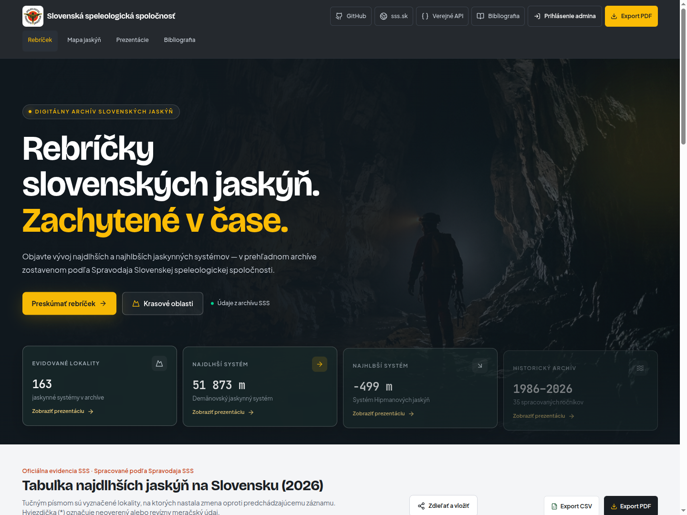
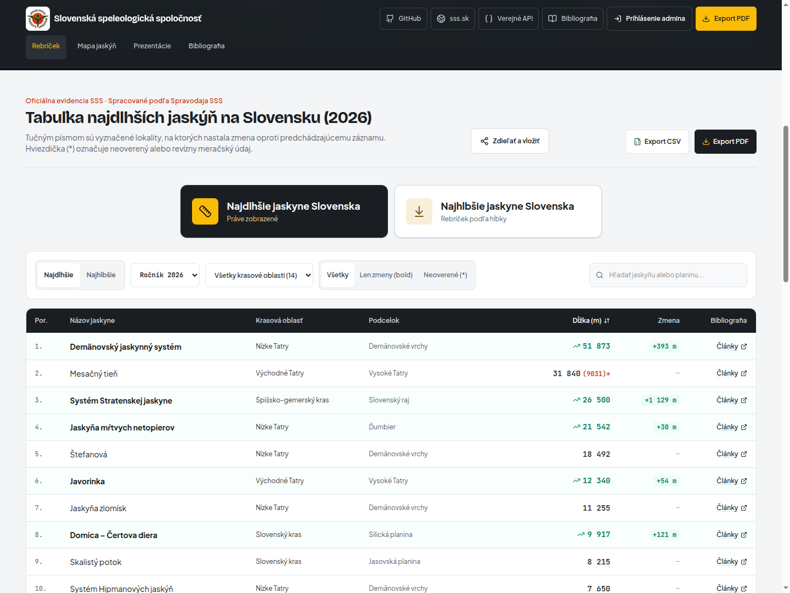
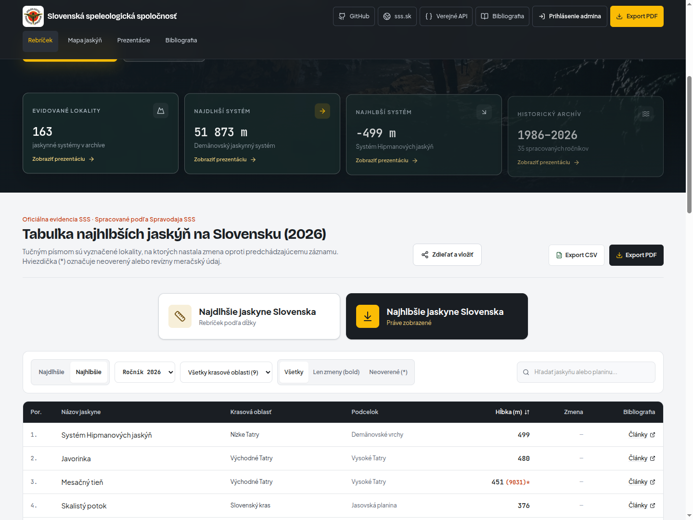
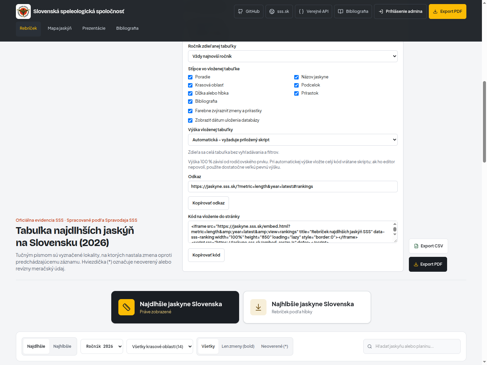
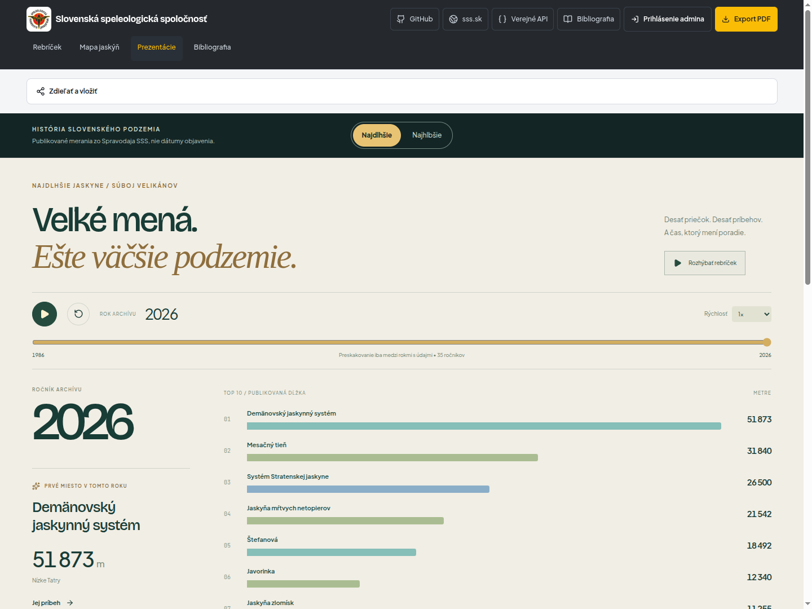

# SSS.sk — Atlas and database of Slovakia's longest and deepest caves

[](https://www.typescriptlang.org/)
[](https://react.dev/)
[](https://expressjs.com/)
[](https://tailwindcss.com/)
[](https://ai.google.dev/)

An information portal, historical archive and analytics tool for the **Slovak Speleological Society ([sss.sk](https://sss.sk/))**. The application processes the official rankings of Slovakia's longest and deepest caves from HTML pages on `sss.sk` and PDF issues of the **Spravodaj SSS** journal (2005–2026), visualizes their development and links them to the specialist bibliography at [`bibliografia.sss.sk`](https://bibliografia.sss.sk/).

**Slovensky:** [README v slovenčine](README.md)

---

## Current screenshots from the live website (20 November 2026)

These screenshots were captured in a browser from the [publicly deployed website](https://jaskyne.sss.sk/).

### Homepage and statistics


### Longest and deepest caves



### Share and iframe settings


### Historical presentation


---

## Features

### 1. Rankings and karst-region map (`CaveAtlasMap`)
- **Homepage:** Opens on the rankings, with search, filters and CSV/PDF export.
- **Map:** The navigation includes a cartographic overview of Slovakia's eight regions, selected towns, major rivers and broad karst-area labels. It does not show cave locations, entrances, GPS coordinates or elevation. Regional boundaries are based on Eurostat GISCO NUTS 2024.
- **Presentations:** Historical development of cave lengths and depths is available as a separate view.

### 2. Official SSS rankings and reports (`RankingsTable`, `exportReports`)
- **Metric and year selection:** View the **longest** or **deepest** caves in Slovakia for any processed year; the default is `2026`.
- **SSS typography:**
  - **Bold text** marks sites whose length or depth changed from the previous record.
  - **An asterisk (`*`)** marks unverified data or ongoing survey revisions (for example, *Mesačný tieň*, `31,840 (9031)*`).
- **Filtering and sorting:** Search by cave or karst-area name, filter by karst region, show only changed or unverified entries, and sort by table columns.
- **Live synchronization:** Administrators can synchronize the current HTML rankings from [`sss.sk/category/rebricky-jaskyn/`](https://sss.sk/category/rebricky-jaskyn/).
- **CSV and PDF exports:**
  - **CSV (UTF-8 with BOM):** Opens in Excel and LibreOffice without corrupting Slovak diacritics.
  - **PDF (`jsPDF` + `jspdf-autotable`):** Print-ready SSS-style reports, including bold changed rows and footnotes for `*`.

### Sharing and embedding rankings
- **Shareable links:** Preserve the selected metric and either a specific year or the latest available year.
- **Configurable iframe:** The “Share and embed” panel lets visitors choose columns, change/increment highlighting, database update date and embed height. The longest and deepest rankings can be embedded separately.
- **Automatic height:** The generated code includes `embed-resize.js` when automatic height is selected; the host page must allow scripts. If an editor blocks scripts, choose a fixed pixel height and use the iframe only.
- **Public ranking pages:** [Longest caves](https://jaskyne.sss.sk/najdlhsie-jaskyne.html), [deepest caves](https://jaskyne.sss.sk/najhlbsie-jaskyne.html) and the [sitemap](https://jaskyne.sss.sk/sitemap.xml).

### 3. Cave details and analytics (`CaveDetailDrawer`, `EvolutionCharts`)
- **Cave detail drawer:** Basic information, karst region and subregion, an interactive SVG chart of surveyed metres over time, measurement history with its *Spravodaj* source issue, and links to the PDF and bibliography.
- **Evolution charts:** GSAP-animated comparisons of leading cave systems and summary statistics for Slovak karst regions.

### 4. Spravodaj SSS PDF AI/OCR — administrators only (`SpravodajOcrPanel`)
- **Issue index from `sss.sk/spravodaj/`:** Loads available *Spravodaj SSS* PDF issues and highlights issues 1 and 2, which traditionally contain the longest/deepest-cave tables.
- **Multimodal AI/OCR with Gemini:**
  - Process a PDF URL, upload a local PDF (including older scans), or paste extracted text.
  - Uses `@google/genai` (`gemini-4-hydrogen`) with a constrained JSON response schema to extract rank, cave name, karst region, subregion, measurements, bold changes (`isBoldChanged`), asterisks (`*`) and footnotes.
- **Review before writing:** Preview extracted rows before committing them to the persistent database.

### 5. Semantic search and linked bibliography (`SemanticBibliographyPanel`, `biblioUrl`)
- **Live integration with `bibliografia.sss.sk`:** Uses the central index at `https://bibliografia.sss.sk/data/articles.json` (5,900+ articles).
- **Gemini semantic queries:** Search in natural language, for example, “deep shafts in the Slovak Karst with changes after 2018,” and get a specialist summary with relevant caves and articles.
- **Canonical article links:** Generated in the `bibliografia.sss.sk/?q=...` format (lowercase, without diacritics, spaces replaced by `+`), for example `https://bibliografia.sss.sk/?q=kunia+priepast` or `https://bibliografia.sss.sk/?q=brazda`.

### 6. Ranking editor — administrators only (`AdminRankingEditor`)
- **Create a year (for example, `2027`):** Start from any existing year's length or depth ranking.
- **Automatic change detection:** Editing a measurement recalculates its `delta` against the reference year and enables **bold** formatting; it can also be adjusted manually.
- **Unverified data (`*`):** Toggle the asterisk and edit a note (for example, `(9031)*`) for each row.
- **Print preview:** Switch to the traditional dotted-line *Spravodaj SSS* layout.
- **Save and export:** Save a full ranking year with `POST /api/admin/save-year`, and export the report to CSV or PDF.

---

## Batch processing of the Spravodaj archive (`scripts/process_spravodaje.ts`)

Run the batch script to populate the database from the official archives:

```bash
npx tsx scripts/process_spravodaje.ts
```

The script:
1. Downloads and parses the current HTML tables at `sss.sk/tabulka-najdlhsich-jaskyn-na-slovensku/` and `sss.sk/tabulka-najhlbsich-jaskyn-na-slovensku/`.
2. Gets the table-article URLs and page numbers from `https://bibliografia.sss.sk/data/articles.json` for 2012–2026.
3. Uses `pdfjs-dist` to read PDF text layers (with a local cache in `/tmp/sss_pdfs`) and handles both historical table formats:
   - **2012–2024:** dotted leader rows, for example `1. Demänovský jaskynný systém, Nízke Tatry, Demänovské vrchy .......... 46 896`.
   - **2025–2026:** modern rows with a cave registry number, for example `..., č. NDJ 5280   51 873`.
4. Normalizes canonical keys and cave IDs (removing trailing footnote indices such as `Suchá jaskyňa 1`, normalizing punctuation and aliases), calculates year-over-year differences (`deltaLengthM`, `deltaDepthM`), marks bold changes and writes the result to `data/caves-db.json` (**117 unique caves**, years **2005–2026**, with no duplicate IDs).

---

## Project structure

```text
.
├── data/
│   └── caves-db.json                 # Persistent cave and annual-record database
├── docs/
│   └── screenshots/                  # Live website screenshots used in the README
├── scripts/
│   └── process_spravodaje.ts         # Batch crawler and PDF parser (2012–2026)
├── src/
│   ├── assets/images/                # Application image assets
│   ├── components/
│   │   ├── AdminRankingEditor.tsx    # New-year editor and print preview
│   │   ├── CaveAtlasMap.tsx          # Regions, towns, rivers and broad karst areas
│   │   ├── CaveDetailDrawer.tsx      # Cave details, SVG history chart and bibliography
│   │   ├── EvolutionCharts.tsx       # Ranking and karst-region summary charts
│   │   ├── RankingsTable.tsx         # Rankings with filters, bold changes and * markers
│   │   ├── SemanticBibliographyPanel.tsx # Semantic search and bibliography.sss.sk
│   │   ├── SpravodajOcrPanel.tsx     # Spravodaj PDF AI/OCR extraction
│   │   └── TopBar.tsx                # Portal navigation header
│   ├── data/
│   │   └── seedCaves.ts              # Starter dataset
│   ├── types/
│   │   └── caves.ts                  # Shared TypeScript types
│   ├── utils/
│   │   ├── biblioUrl.ts              # Canonical ?q= bibliography-link generator
│   │   └── exportReports.ts          # CSV (BOM) and PDF exports (jsPDF)
│   ├── App.tsx                       # Main application and state management
│   ├── index.css                     # Tailwind CSS v4, typography and SSS color variables
│   └── main.tsx                      # React entry point
├── server.ts                         # Express backend, Vite middleware and Gemini API
├── metadata.json                     # Portal metadata
├── package.json                      # Scripts and dependencies
└── vite.config.ts                    # Vite configuration
```

---

## API

The local Express backend (`server.ts`) listens on port `3000` (or the port configured with `PORT`). Production builds also include a PHP implementation for standard web hosting. See [php/README.md](php/README.md) for requirements and deployment steps (currently in Slovak).

| Method | Endpoint | Description |
| :--- | :--- | :--- |
| `GET` | `/api/auth/session` | Returns administrator session state (`{ authenticated, username? }`). |
| `POST` | `/api/auth/login` | Signs in with `{ username, password }` and sets an `HttpOnly`, `SameSite=Strict` session cookie. |
| `POST` | `/api/auth/logout` | Clears the administrator session cookie. |
| `GET` | `/api/caves` | Returns caves as `{ caves, updatedAt }`, without coordinates or elevation. `updatedAt` is the database file's last-modified time in ISO 8601 UTC, or `null` if unavailable. |
| `GET` | `/api/sss/issues` | Downloads the available PDF issues from `sss.sk/spravodaj/` (with a fallback cached index). |
| `POST` | `/api/sss/sync-rankings` | Admin only: synchronizes and merges the HTML rankings from `sss.sk`. |
| `GET` | `/api/bibliography?q=...&limit=40` | Proxies and searches `bibliografia.sss.sk/data/articles.json`. |
| `POST` | `/api/search/semantic` | Gemini semantic search across caves and bibliography (`{ query }`). |
| `POST` | `/api/extract/pdf` | Admin only: Gemini AI/OCR extraction from `pdfUrl`, `pdfBase64` or `rawText`. |
| `POST` | `/api/caves/import-extraction` | Admin only: saves a confirmed AI/OCR extraction and recalculates year-over-year deltas. |
| `POST` | `/api/admin/save-year` | Admin only: saves or updates a complete ranking year from the editor. |

Unauthenticated requests to protected operations receive HTTP `401`. Local Express uses non-production default credentials; production requires custom `ADMIN_USERNAME`, `ADMIN_PASSWORD`, an HTTPS `APP_URL` and `SESSION_SECRET`. The PHP deployment uses a separate private configuration with a password hash; see [php/README.md](php/README.md).

### Example `POST /api/admin/save-year` request

```json
{
  "year": 2027,
  "metric": "length",
  "statusDate": "1 March 2027",
  "author": "Ján Tencer",
  "footnote": "* Measurement from an ongoing polygon revision.",
  "rows": [
    {
      "rank": 1,
      "caveId": "demanovsky-jaskynny-system",
      "name": "Demänovský jaskynný systém",
      "karstRegion": "Nízke Tatry",
      "subUnit": "Demänovské vrchy",
      "valueM": 52140,
      "isBoldChanged": true,
      "isUnverified": false
    }
  ]
}
```

---

## Installation and development

### 1. Requirements
- **Node.js** `>= 20.x`
- **npm**
- Optional **`GEMINI_API_KEY`** for AI/OCR and semantic search. Browsing, exports, the admin editor and lexical search fallback work without it.
- **`SESSION_SECRET`** for production Express; generate one with `openssl rand -hex 32`.

### 2. Environment configuration

Copy `.env.example` to `.env` and set server-side values:

```bash
cp .env.example .env
```

Example `.env` values:

```env
GEMINI_API_KEY="your-gemini-api-key"
ADMIN_USERNAME="your-admin-username"
ADMIN_PASSWORD="your-own-long-random-password"
SESSION_SECRET="value-from-openssl-rand-hex-32"
PORT="3000"
APP_URL="https://your-public-domain.example"
```

In local development, an empty `SESSION_SECRET` is replaced with a random key for that server run. In production, `APP_URL` must be the public HTTPS domain; the sitemap is generated from it. These authentication variables apply to Express. PHP hosting uses `php/setup.php` and a separate configuration outside the web root. Never put real passwords in documentation or commit them to the repository.

### 3. Install dependencies and start the development server

```bash
npm install
npm run dev
```

The application is available at `http://localhost:3000`.

### 4. Production build and deployment

```bash
npm run build
npm start
```

`npm run build` generates the PHP API, Apache rewrite rule and a sanitized snapshot at `dist/data/caves.json` without coordinates. PHP administration requires PHP, `/api/*` rewrite rules, and a private database and configuration outside the web root. Uploading `dist/` alone is not sufficient; follow [php/README.md](php/README.md).

### 5. Type checks and tests

```bash
npm run lint
node --import tsx --test src/utils/share.test.ts
php php/tests/integration.php
php php/tests/setup.php
```

To rebuild the historical dataset from the archive, run `npx tsx scripts/process_spravodaje.ts`. This script downloads source material and updates `data/caves-db.json`; review its output and data changes before publishing.

---

## Data methodology and conservation

- **Cave protection:** The website does not display cave locations, entrances, GPS coordinates or elevations. The map shows regional boundaries and broad karst areas, not individual cave locations.
- **Sources:** Official statistics compiled by Ján Tencer and published in *Spravodaj SSS*, ranking tables on [`sss.sk`](https://sss.sk/category/rebricky-jaskyn/) and the [`bibliografia.sss.sk`](https://bibliografia.sss.sk/) archive.
