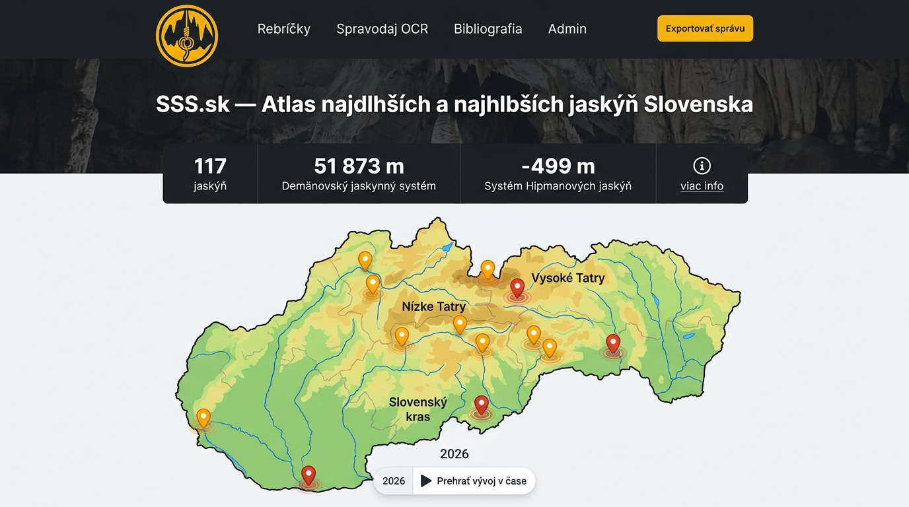
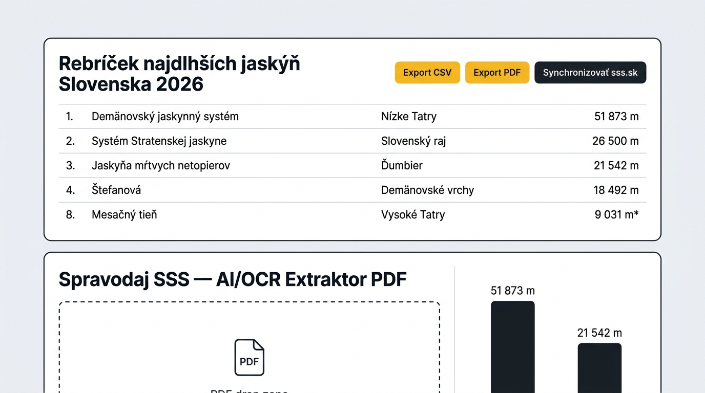
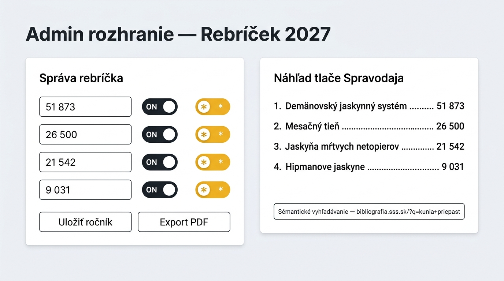

# SSS.sk — Atlas a databáza najdlhších a najhlbších jaskýň Slovenska

[](https://www.typescriptlang.org/)
[](https://react.dev/)
[](https://expressjs.com/)
[](https://tailwindcss.com/)
[](https://ai.google.dev/)

Moderný informačný portál, historický archív a analytický nástroj pre **Slovenskú speleologickú spoločnosť ([sss.sk](https://sss.sk/))**. Aplikácia automatizovane spracúva oficiálne rebríčky najdlhších a najhlbších jaskýň Slovenska z HTML stránok `sss.sk` a PDF vydaní časopisu **Spravodaj SSS** (ročníky 2005–2026), vizualizuje ich vývoj na interaktívnej mape a spája ich s odbornou bibliografiou na [`bibliografia.sss.sk`](https://bibliografia.sss.sk/).

---

## Ukážky aplikácie (Screenshots)

### 1. Interaktívny atlas, KPI prehľad a farebná topografická mapa Slovenska

*Hlavná obrazovka s kľúčovými ukazovateľmi (KPI) pre vybraný ročník, farebne rozlíšenými krasovými oblasťami Slovenska, riečnou sieťou a časovou osou na animované prehrávanie objavov a zmien v čase.*

### 2. Oficiálne rebríčky SSS, exporty (CSV/PDF) a AI/OCR extraktor Spravodaja

*Tabuľka najdlhších a najhlbších jaskýň s automatickým tučným zvýraznením medziročných zmien, poznámkami `*` pre nepotvrdené merania, tlačidlami na CSV/PDF export a modulom pre AI/OCR extrakciu PDF čísel Spravodaja.*

### 3. Admin rozhranie pre tvorbu budúcich ročníkov a sémantická bibliografia

*Rýchly editor na prípravu rebríčka pre nasledujúci rok (napr. 2027) s automatickým tučným písmom pri zmene hodnôt, prepínačom `*`, klasickým bodkovým náhľadom tlače a prepojením na sémantické vyhľadávanie v bibliografii SSS.*

---

## Kompletný prehľad funkcií

### 1. Interaktívny krasový atlas a animácia vývoja v čase (`CaveAtlasMap`)
- **Farebná topografická mapa Slovenska (WGS84 SVG):** Obsahuje terénny reliéf karpatských celkov, farebne odlíšené hlavné krasové územia (*Nízke Tatry*, *Vysoké a Belianske Tatry*, *Západné Tatry*, *Slovenský kras*, *Spišsko-gemerský kras*, *Malé Karpaty*, *Veľká Fatra*, *Strážovské vrchy*) a riečnu sieť (*Váh*, *Hron*, *Hornád*).
- **Ovládanie a navigácia:** Približovanie, posun myšou (pan/zoom), reset pohľadu a živý súradnicový HUD kurzora (zemepisná šírka/dĺžka).
- **Časová os (`Prehrať vývoj v čase`):** Automaticky krokuje naprieč historickými ročníkmi (2005–2026) s vizuálne odlíšenými **GSAP animáciami**:
  - **Nová jaskyňa v danom roku:** výrazná trojitá pulzujúca rázová vlna, svetelný záblesk a pružné zväčšenie bodu.
  - **Zmenená jaskyňa (nárast dĺžky alebo hĺbky):** jemnejší svetelný prstenec na decentné upozornenie bez vizuálneho zahltenia.

### 2. Oficiálne rebríčky SSS a reporty (`RankingsTable`, `exportReports`)
- **Prepínanie metriky a ročníka:** Zobrazenie rebríčka **Najdlhších** alebo **Najhlbších** jaskýň Slovenska pre ľubovoľný spracovaný rok (predvolene `2026`).
- **Typografická konvencia SSS:**
  - **Tučné písmo (`bold`)** automaticky označuje lokality, na ktorých nastala zmena dĺžky alebo hĺbky oproti predchádzajúcemu ročníku.
  - **Hviezdička (`*`)** označuje nepotvrdené údaje alebo pokračujúce revízne merania stabilizovaného polygónu (napr. *Mesačný tieň* `31 840 (9031)*`).
- **Filtrovanie a radenie:** Fulltextové vyhľadávanie podľa názvu jaskyne, filter krasovej oblasti, zobrazenie iba zmenených položiek a klikateľné radenie stĺpcov.
- **Živá synchronizácia:** Tlačidlo **Synchronizovať sss.sk** na stiahnutie aktuálnych HTML tabuliek z [`sss.sk/category/rebricky-jaskyn/`](https://sss.sk/category/rebricky-jaskyn/).
- **Exporty do CSV a PDF:**
  - **CSV (UTF-8 s BOM):** Priame otvorenie v Exceli / LibreOffice bez poškodenia slovenskej diakritiky.
  - **PDF (`jsPDF` + `jspdf-autotable`):** Profesionálna tlačová zostava v štýle SSS vrátane tučných riadkov zmien a poznámok pod čiarou pre `*`.

### 3. Detail lokality a analytické grafy (`CaveDetailDrawer`, `EvolutionCharts`)
- **Výsuvný detail jaskyne:** Základné parametre, krasová oblasť a podcelok, interaktívna SVG krivka vývoja zameraných metrov naprieč rokmi, kompletná tabuľka histórie meraní so zdrojovým vydaním *Spravodaja* a priamymi odkazmi na PDF a bibliografiu.
- **Vývojové grafy:** GSAP-animované stĺpcové porovnania top jaskynných systémov a súhrnné štatistiky podľa jednotlivých krasových oblastí Slovenska.

### 4. AI/OCR extrakcia PDF vydaní Spravodaja SSS (`SpravodajOcrPanel`)
- **Index vydaní zo `sss.sk/spravodaj/`:** Automaticky načítava zoznam dostupných PDF čísel *Spravodaja SSS* so zvýraznením čísel 1 a 2, ktoré tradične obsahujú tabuľky najdlhších a najhlbších jaskýň.
- **Multimodálne AI/OCR spracovanie (Gemini):**
  - Podporuje spracovanie cez **URL PDF súboru**, **nahratie lokálneho PDF** (vrátane starších naskenovaných ročníkov) alebo **vloženie surového textu** z PDF.
  - Využíva `@google/genai` (`gemini-4-hydrogen`) s vynútenou JSON schémou (`responseSchema`) na extrakciu poradia, názvu, krasovej oblasti, podcelku, metrov, tučných zmien (`isBoldChanged`), hviezdičiek (`*`) a poznámok pod čiarou.
- **Kontrola pred zápisom:** Zobrazuje náhľad extrahovaných riadkov s možnosťou jednorazového uloženia do perzistentnej databázy.

### 5. Sémantické vyhľadávanie a prepojená bibliografia (`SemanticBibliographyPanel`, `biblioUrl`)
- **Živá integrácia s `bibliografia.sss.sk`:** Napojenie na centrálny index `https://bibliografia.sss.sk/data/articles.json` (5 900+ článkov).
- **Sémantické dopyty cez Gemini:** Vyhľadávanie v prirodzenom jazyku (napr. *"hlboké priepasti v Slovenskom krase so zmenami po roku 2018"*) s odborným zhrnutím a relevantnými jaskyňami aj článkami.
- **Presný formát odkazov:** Všetky odkazy na články a témy sa generujú v kanonickom vyhľadávacom tvare `bibliografia.sss.sk/?q=...` (malé písmená, bez diakritiky, medzery nahradené `+`, napr. `https://bibliografia.sss.sk/?q=kunia+priepast` alebo `https://bibliografia.sss.sk/?q=brazda`).

### 6. Admin rozhranie pre tvorbu budúcich rebríčkov (`AdminRankingEditor`)
- **Rýchle založenie ročníka (napr. `2027`):** Jedným kliknutím predvyplní kompletnú tabuľku z ľubovoľného existujúceho ročníka (dĺžky alebo hĺbky).
- **Automatická detekcia zmien:** Pri úprave číselnej hodnoty sa okamžite vypočíta rozdiel (`delta`) oproti referenčnému roku a automaticky sa aktivuje **tučné písmo** (`bold`) s možnosťou ručného doladenia.
- **Správa nepotvrdených údajov (`*`):** Rýchly prepínač hviezdičky a textová poznámka (napr. `(9031)*`) pre každý riadok.
- **Klasický náhľad tlače:** Prepínateľný režim **Náhľad tlače Spravodaja** zobrazí rebríček v tradičnej bodkovanej úprave známej zo *Spravodaja SSS*.
- **Okamžité uloženie a export:** Priame uloženie ročníka do databázy (`POST /api/admin/save-year`) a okamžitý export zostavy do **CSV** a **PDF**.

---

## Dávkové spracovanie archívu Spravodajov (`scripts/process_spravodaje.ts`)

Pre jednorazové alebo periodické hromadné naplnenie databázy priamo z oficiálnych archívov je pripravený dávkový skript:

```bash
npx tsx scripts/process_spravodaje.ts
```

**Čo skript robí:**
1. Stiahne a zparsuje aktuálne HTML tabuľky zo `sss.sk/tabulka-najdlhsich-jaskyn-na-slovensku/` a `sss.sk/tabulka-najhlbsich-jaskyn-na-slovensku/`.
2. Získa presné URL a čísla strán tabuľkových článkov z `https://bibliografia.sss.sk/data/articles.json` pre ročníky **2012–2026**.
3. Pomocou `pdfjs-dist` načíta textové vrstvy jednotlivých PDF (s lokálnou cache v `/tmp/sss_pdfs`) a spracuje oba historické formáty tabuliek:
   - **Formát 2012–2024:** riadky s bodkovými vodiacimi čiarami (`1. Demänovský jaskynný systém, Nízke Tatry, Demänovské vrchy .......... 46 896`).
   - **Formát 2025–2026:** modernizované riadky s evidenčným číslom (`..., č. NDJ 5280   51 873`).
4. Zjednotí kánonické kľúče a ID jaskýň (odstráni koncové poznámkové indexy ako `Suchá jaskyňa 1`, normalizuje interpunkciu a aliasy), vypočíta medziročné rozdiely (`deltaLengthM`, `deltaDepthM`), vyznačí tučné zmeny a uloží čistý výsledok do `data/caves-db.json` (**117 unikátnych jaskýň**, ročníky **2005–2026**, bez duplicitných ID).

---

## Štruktúra projektu

```text
.
├── data/
│   └── caves-db.json                 # Perzistentná JSON databáza jaskýň a ročných záznamov
├── docs/
│   └── screenshots/                  # Ukážky UI pre dokumentáciu (GitHub README)
├── scripts/
│   └── process_spravodaje.ts         # Dávkový crawler a PDF parser (2012–2026)
├── src/
│   ├── assets/images/                # Vizuálne podklady aplikácie
│   ├── components/
│   │   ├── AdminRankingEditor.tsx    # Admin editor pre nové ročníky + náhľad tlače
│   │   ├── CaveAtlasMap.tsx          # Farebná topografická mapa SR + GSAP animácia v čase
│   │   ├── CaveDetailDrawer.tsx      # Detail jaskyne, SVG graf vývoja a bibliografia
│   │   ├── EvolutionCharts.tsx       # Súhrnné grafy prírastkov a krasových oblastí
│   │   ├── RankingsTable.tsx         # Oficiálny rebríček s filtrami, bold a * značkami
│   │   ├── SemanticBibliographyPanel.tsx # Sémantické vyhľadávanie + bibliografia.sss.sk
│   │   ├── SpravodajOcrPanel.tsx     # AI/OCR extraktor PDF čísel Spravodaja
│   │   └── TopBar.tsx                # Navigačná hlavička portálu
│   ├── data/
│   │   └── seedCaves.ts              # Základný štartovací dataset
│   ├── types/
│   │   └── caves.ts                  # Zdieľané TypeScript rozhrania
│   ├── utils/
│   │   ├── biblioUrl.ts              # Generátor kanonických odkazov ?q=pre+bibliografiu
│   │   └── exportReports.ts          # Generovanie CSV (BOM) a PDF reportov (jsPDF)
│   ├── App.tsx                       # Hlavná aplikácia a správa stavu
│   ├── index.css                     # Tailwind CSS v4 + typografia + farebné premenné SSS
│   └── main.tsx                      # Vstupný bod React aplikácie
├── server.ts                         # Express backend + Vite middleware + Gemini API
├── metadata.json                     # Metadata portálu
├── package.json                      # Skripty a závislosti
└── vite.config.ts                    # Konfigurácia Vite
```

---

## API Dokumentácia (`server.ts`)

Backend beží na rovnakom porte (`3000`) ako Vite dev server alebo produkčný statický build.

| Metóda | Endpoint | Popis |
| :--- | :--- | :--- |
| `GET` | `/api/caves` | Vráti kompletný zoznam deduplikovaných jaskýň (`{ caves }`) z `data/caves-db.json`. |
| `GET` | `/api/sss/issues` | Stiahne aktuálny zoznam PDF vydaní z `sss.sk/spravodaj/` (s fallback cache zoznamom). |
| `POST` | `/api/sss/sync-rankings` | Zosynchronizuje HTML tabuľky z `sss.sk` a zlúči ich s databázou. |
| `GET` | `/api/bibliography?q=...&limit=40` | Proxy a fulltextový filter nad `bibliografia.sss.sk/data/articles.json`. |
| `POST` | `/api/search/semantic` | Sémantické AI vyhľadávanie (Gemini) cez jaskyne aj bibliografické články (`{ query }`). |
| `POST` | `/api/extract/pdf` | AI/OCR extrakcia tabuľky z `pdfUrl`, `pdfBase64` alebo `rawText` pomocou Gemini. |
| `POST` | `/api/caves/import-extraction` | Zápis potvrdenej AI/OCR extrakcie do databázy a prepočet medziročných delt. |
| `POST` | `/api/admin/save-year` | Uloženie alebo aktualizácia celého ročníka rebríčka z Admin editora. |

### Príklad požiadavky na `POST /api/admin/save-year`
```json
{
  "year": 2027,
  "metric": "length",
  "statusDate": "1. 3. 2027",
  "author": "Ján Tencer",
  "footnote": "* Údaj z pokračujúceho revízneho merania polygónu.",
  "rows": [
    {
      "rank": 1,
      "caveId": "demanovsky-jaskynny-system",
      "name": "Demänovský jaskynný systém",
      "karstRegion": "Nízke Tatry",
      "subUnit": "Demänovské vrchy",
      "valueM": 52140,
      "isBoldChanged": true,
      "isUnverified": false
    }
  ]
}
```

---

## Inštalácia a spustenie

### 1. Požiadavky
- **Node.js** `>= 20.x`
- **npm**
- Voliteľne **GEMINI_API_KEY** (pre AI/OCR extrakciu PDF a sémantické vyhľadávanie; bez kľúča funguje lexikálny fallback vyhľadávania a plné prehliadanie, exporty aj Admin editor)

### 2. Konfigurácia prostredia
Skopírujte `.env.example` na `.env` a nastavte váš kľúč na serverovej strane:
```bash
cp .env.example .env
```
Obsah `.env`:
```env
GEMINI_API_KEY="vas_gemini_api_kluc"
APP_URL="http://localhost:3000"
```

### 3. Inštalácia závislostí a vývojový server
```bash
npm install
npm run dev
```
Aplikácia bude dostupná na `http://localhost:3000`.

### 4. Produkčný build a spustenie
```bash
npm run build
npm start
```

### 5. Kontrola typov a obnova dát z archívu
```bash
npm run lint
npx tsx scripts/process_spravodaje.ts
```

---

## Metodika dát a ochrana prírody

- **Ochrana lokalít:** V súlade so zákonom o ochrane prírody a krajiny verejné rebríčky SSS neobsahujú presné GPS súradnice vchodov do jaskýň. Body na interaktívnej mape sú umiestnené deterministicky v rámci príslušného krasového celku a geomorfologického podcelku (napr. *Demänovské vrchy*, *Silická planina*, *Muránska planina*).
- **Zdroje:** Oficiálne štatistiky zostavovateľa Jána Tencera publikované v *Spravodaji SSS*, webové tabuľky na [`sss.sk`](https://sss.sk/category/rebricky-jaskyn/) a archív [`bibliografia.sss.sk`](https://bibliografia.sss.sk/).
